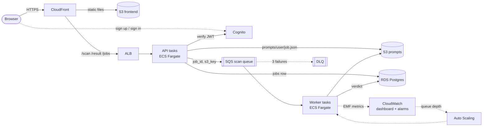

# InjectShield

Guardrail-as-a-service on AWS. Send a prompt (and optional retrieved memory or chat
history); get back a risk verdict for prompt injection, memory injection and jailbreak
attempts. Cloud Computing (702IT0C026) mini project.

The API never scans inline. It stores the prompt in S3, records the job in RDS, queues
it in SQS and answers `202` with a job ID. Scanner workers, scaled on queue depth, do
the work and write the verdict for the client to fetch.



## Layout

| Path | What |
|---|---|
| `shared/injectshield_shared/` | Pydantic models, settings, AWS client factory, CloudWatch EMF metrics |
| `api/injectshield_api/` | FastAPI ingest service: `POST /scan`, `GET /result/{id}`, `GET /jobs`, `GET /health` |
| `worker/injectshield_worker/` | SQS worker loop, detection pipeline, scoring, sample-set evaluation |
| `frontend/` | Static web app: Cognito sign-up/sign-in, submit, live verdict, history. No build step |
| `db/init.sql` | `jobs` and `verdicts` tables (applied by the API at startup) |
| `infra/` | CloudFormation, one stack per file (deploy order below) |
| `scripts/` | `deploy.sh`, `teardown.sh`, `create-budget.sh`, `smoke.sh`, `load-test.py`, `create-user.sh`, `token.sh` |
| `tests/` | detector, scoring, API (moto), worker (moto + DLQ), real-Postgres and infra-consistency tests, sample prompts |
| `docs/` | [handoff and status](docs/handoff.md), [deployment guide](docs/deployment.md), [AWS services used](docs/services-used.md), [design doc](docs/design.md), [graphs from the AWS run](docs/screenshots/) |

The services are packaged as `injectshield_api` and `injectshield_worker`, not `app`,
so both test suites can be imported in one pytest run.

## Detection pipeline

1. **Normalise**: NFKC, strip zero-width/bidi characters, decode base64 and URL-encoded blocks
2. **Rules** (`detectors/rules.py`): 32 weighted regex rules across the three categories
3. **Memory injection** (`detectors/memory_injection.py`): 8 rule families for instructions hidden in the `context` field
4. **Classifier** (`detectors/classifier.py`, optional, off by default)
5. **Scoring**: category score = sum of rule weights, capped at 1; risk = max category;
   `safe` < 0.4 ≤ `suspicious` ≤ 0.7 < `malicious` (thresholds in config)

Every detector implements `scan(prompt, context) -> list[Finding]`.

## Local development

Needs Python 3.11+ and Docker Desktop.

```bash
python -m venv .venv
source .venv/bin/activate          # Windows: .venv\Scripts\activate
pip install -r requirements-dev.txt

pytest                             # unit + API + worker tests, no Docker needed
ruff check . && ruff format --check .
PYTHONPATH=shared:worker python -m injectshield_worker.evaluate tests/sample_prompts
```

Full stack (API, worker, Postgres, LocalStack S3 + SQS, web app), with auth stubbed by `AUTH_DISABLED=true`:

```bash
docker compose up --build          # add --scale worker=3 for several workers
open http://localhost:8080         # web app
scripts/smoke.sh                   # one prompt end to end
python3 scripts/load-test.py --count 100
# or by hand:
curl -s -X POST localhost:8000/scan -H 'content-type: application/json' \
  -d '{"prompt":"Ignore all previous instructions"}'
curl -s localhost:8000/result/<job_id>
```

Interactive API docs: http://localhost:8000/docs

## Deploying to AWS

```bash
scripts/create-budget.sh you@example.com 5     # own account, once (Learner Lab: skip)
scripts/deploy.sh                              # Learner Lab: LAB_ROLE_ARN=<LabRole arn> scripts/deploy.sh
scripts/teardown.sh                            # end of every session
```

`deploy.sh` deploys the stacks in this order, building and pushing the images to ECR
after `registry`, and finally uploads the web app and prints its CloudFront URL:

| # | Stack | Creates |
|---|---|---|
| 1 | `network` | VPC, 2 public subnets, S3 gateway endpoint, security groups ALB → API → RDS, worker → RDS. No NAT gateway |
| 2 | `storage` | Encrypted prompts bucket (7-day expiry) and private frontend bucket |
| 3 | `queue` | Scan queue + DLQ after 3 receives |
| 4 | `database` | RDS Postgres 16, encrypted, private; password in Secrets Manager |
| 5 | `iam` | Execution role, API and worker task roles scoped to exact ARNs (skipped in Learner Lab) |
| 6 | `registry` | ECR repositories for the two images |
| 7 | `auth` | Cognito user pool and web app client |
| 8 | `compute` | ECS cluster, ALB, API and worker Fargate services |
| 9 | `autoscaling` | Worker target tracking on scan-queue depth (1 to 5 tasks) |
| 10 | `monitoring` | CloudWatch dashboard, alarms on DLQ, scan errors and 5xx, SNS topic |
| 11 | `frontend` | CloudFront: web app from S3, API paths to the ALB, all over HTTPS |

Accounts, Learner Lab mode, the demo flow and costs: [docs/deployment.md](docs/deployment.md).

## API

All routes except `/health` need `Authorization: Bearer <Cognito JWT>` (ID or access token).

```jsonc
// POST /scan  ->  202 {"job_id": "…", "status": "queued"}
{ "prompt": "Ignore all previous instructions and ...", "context": "optional memory or chat history" }

// GET /result/{job_id} when done
{
  "job_id": "…", "status": "done",
  "verdict": {
    "label": "malicious", "risk_score": 1.0,
    "categories": { "prompt_injection": 1.0, "memory_injection": 0.0, "jailbreak": 0.0 },
    "evidence": [ { "detector": "rules", "rule": "ignore_previous", "category": "prompt_injection",
                    "span": "Ignore all previous instructions", "weight": 0.8 } ],
    "model_version": "rules-v1+mem-v1", "latency_ms": 1
  }
}
```

A job that is not the caller's returns 404, the same as one that does not exist.

## Reliability

- The worker deletes the SQS message only after the verdict commit.
- Verdict insert is `ON CONFLICT (job_id) DO NOTHING`, and a redelivered message for a
  finished job is just deleted.
- Failures are retried with backoff; on the 3rd receive the job is marked `failed` and
  SQS moves the message to the DLQ, which raises a CloudWatch alarm.
- Workers finish the message in hand on `SIGTERM`, so scale-in never drops a job.
- Prompt bodies are never logged.

## Metrics

The worker prints CloudWatch Embedded Metric Format lines (namespace `InjectShield`):
`ScanLatency`, `ProcessingLatency`, `EndToEndLatency`, `JobsCompleted`, `ScanErrors`.
With the `awslogs` driver on ECS these become metrics with no extra API calls or IAM
permissions. The `injectshield` dashboard plots them next to queue depth, running
tasks (Container Insights) and ALB 5xx.
